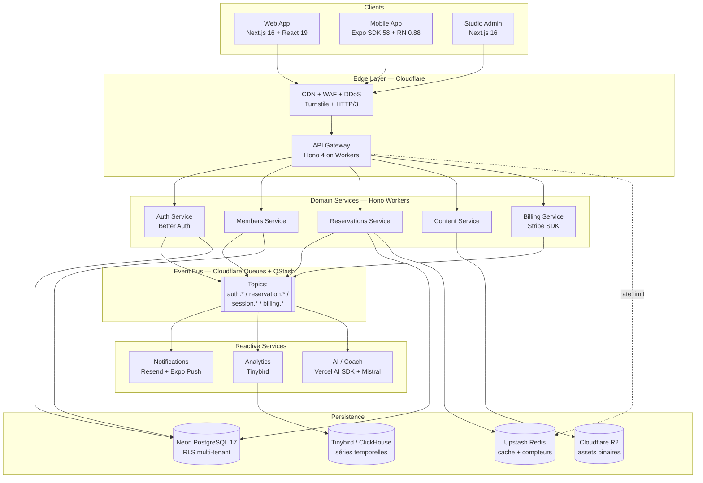
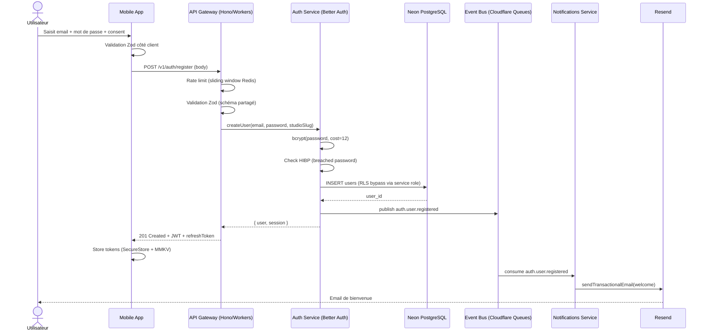
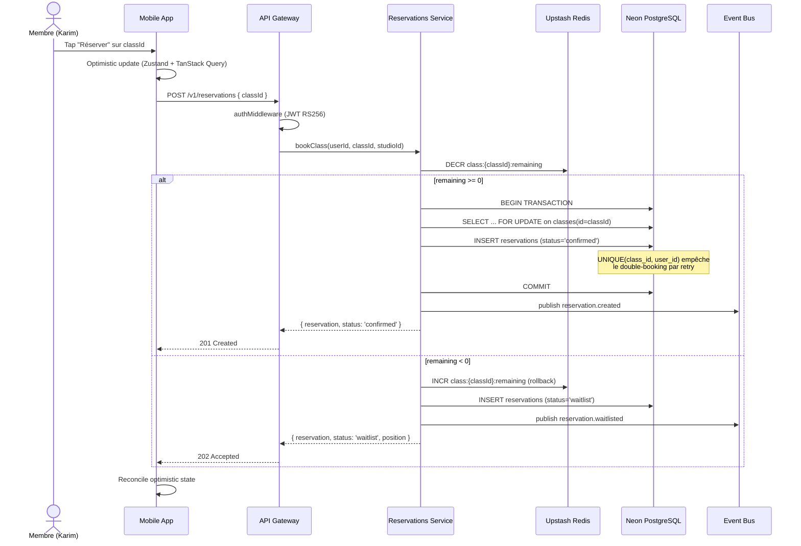
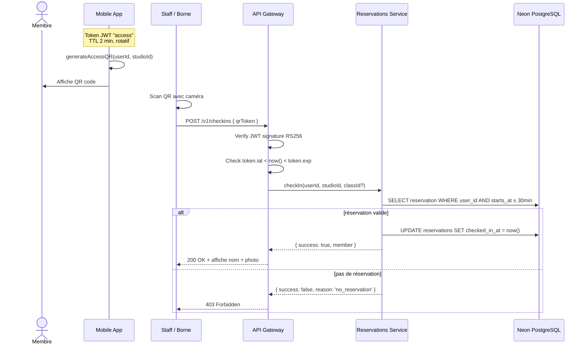
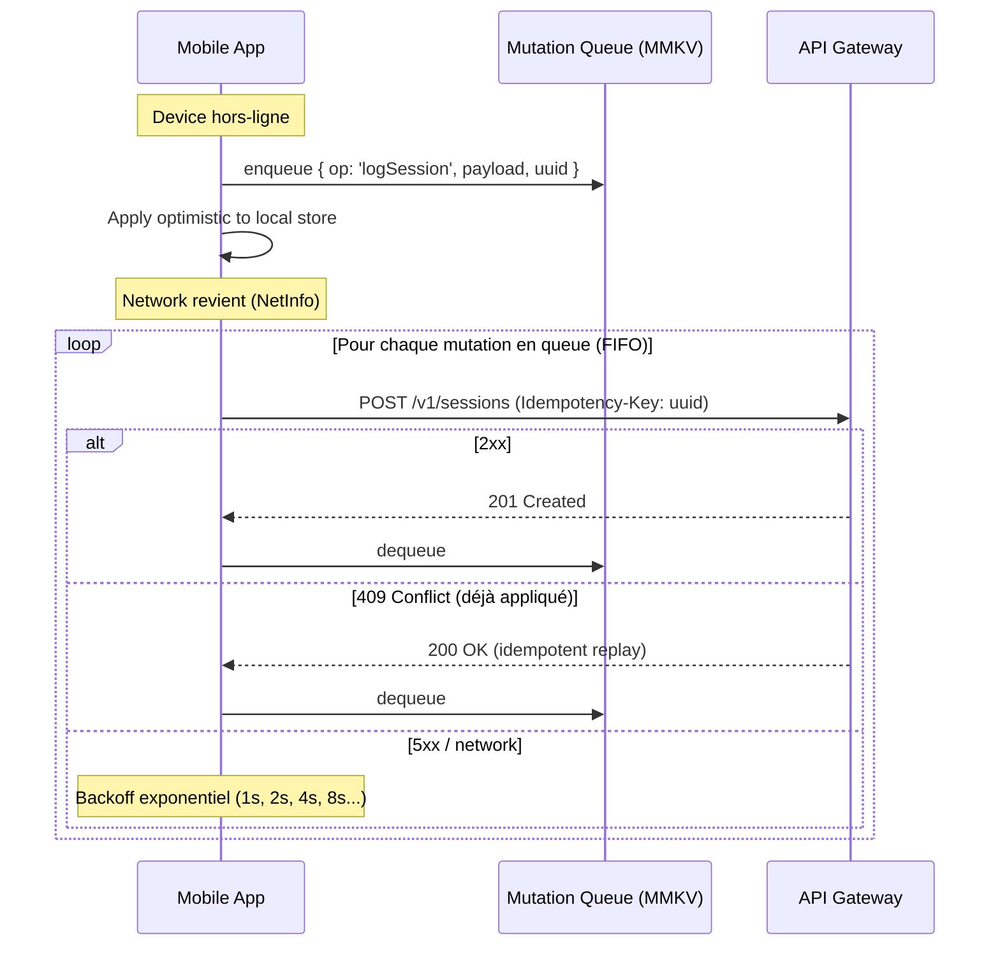

# Design Document: Athlya Platform

## Overview

Athlya est une plateforme fitness open-source, multi-tenant, event-driven et RGPD-first, conçue comme alternative aux SaaS propriétaires (bsport, Mywellness, Mindbody). Elle cible les studios boutique (yoga, crossfit, boxe), les chaînes mid-size, les coachs indépendants et les communautés sportives, avec un engagement fort sur l'ownership des données, la résilience by-design et l'edge-first.

Le système est un monorepo Turborepo composé de trois applications clients (web Next.js 16, mobile Expo/React Native SDK 58, studio admin Next.js) et d'une API edge en Hono 4 déployée sur Cloudflare Workers. La persistance repose sur Neon PostgreSQL 17 (relationnel + RLS multi-tenant), Upstash Redis (cache chaud, compteurs, rate limits), Cloudflare R2 (assets) et Tinybird/ClickHouse (analytics). Les domaines métier (Auth, Members, Reservations, Content, Billing, Notifications, Analytics, AI/Coach) communiquent via un bus d'événements asynchrone composé de **Cloudflare Queues** (événements temps réel, retry/DLQ natifs) et **Upstash QStash** (jobs différés / planifiés — ex. rappels 1 h avant cours). Upstash Kafka, initialement envisagé, a été écarté : le service a été déprécié en septembre 2024 et discontinué le 11 mars 2025.

L'architecture applique quatre axiomes structurels : (1) chaque domaine vit dans son propre service avec des contrats d'API stricts, (2) aucun service n'est un point de défaillance unique grâce aux circuit breakers et fallbacks, (3) l'état client précède le réseau (mode offline avec queue de mutations persistée MMKV), (4) l'infrastructure est déclarative et reproductible (IaC, migrations expand/contract, blue/green). Cible SLO : p99 < 500 ms, availability 99,9 %, zéro double-booking sous contention.

## Architecture

### Vue d'ensemble du système



### Principes directeurs

1. **Edge-first** — toutes les requêtes entrantes sont terminées au plus près de l'utilisateur (Cloudflare PoP européen) avant d'atteindre Neon.
2. **Event-driven** — les side-effects (emails, push, analytics, recompute agrégats) sont déclenchés par des événements asynchrones publiés sur Cloudflare Queues (et QStash pour les tâches différées), jamais en RPC synchrone dans la requête utilisateur.
3. **Local-first** — l'app mobile stocke l'état en MMKV et reste opérationnelle en lecture 72 h hors-ligne ; les écritures sont bufferisées dans une queue persistée.
4. **Zero-trust / defense in depth** — JWT vérifié à l'edge, RLS PostgreSQL comme dernier rempart, validation Zod stricte à chaque frontière.

## Sequence Diagrams

### Flow 1 — Inscription et activation d'un membre



### Flow 2 — Réservation d'un cours (le cœur critique)



### Flow 3 — Check-in QR code à la salle



### Flow 4 — Synchronisation offline (mobile)



## Components and Interfaces

### Component 1: API Gateway (Hono on Workers)

**Purpose** : Terminaison HTTPS edge, authentification, rate limiting, validation Zod, routing vers services de domaine, observabilité.

**Interface** :

```typescript
// packages/api/src/index.ts
interface GatewayContext {
  userId: string | null;
  studioId: string | null;
  role: 'member' | 'coach' | 'admin' | null;
  traceId: string; // W3C traceparent
}

interface GatewayApp {
  // Middlewares appliqués dans l'ordre
  use(middleware: Middleware): this;
  // Routes /v1/*
  route(basePath: string, subApp: Hono): this;
  // Handler global d'erreurs → JSON RFC 7807 Problem Details
  onError(handler: ErrorHandler): this;
}
```

**Responsibilities** :

- Vérifier la signature JWT RS256 et injecter `userId`, `studioId`, `role` dans le contexte.
- Appliquer un rate limit sliding window (Upstash Redis) : 100 rps/IP + 500 rps/user.
- Valider le body/query/params avec les schémas Zod partagés de `packages/shared`.
- Router vers le sous-app Hono du domaine concerné (`/v1/auth`, `/v1/members`, `/v1/reservations`, ...).
- Propager le `traceparent` W3C et émettre les spans OpenTelemetry vers Baselime.
- Convertir toutes les erreurs en RFC 7807 Problem Details (content-type `application/problem+json`).

### Component 2: Auth Service

**Purpose** : Gestion des identités, sessions, providers OAuth, biométrie, RBAC.

**Interface** :

```typescript
// packages/auth/src/index.ts
interface AuthService {
  register(input: RegisterInput): Promise<Result<Session, AuthError>>;
  login(input: LoginInput): Promise<Result<Session, AuthError>>;
  loginWithApple(idToken: string): Promise<Result<Session, AuthError>>;
  loginWithGoogle(idToken: string): Promise<Result<Session, AuthError>>;
  refresh(refreshToken: string): Promise<Result<Session, AuthError>>;
  logout(refreshToken: string): Promise<Result<void, AuthError>>;
  deleteMe(userId: UserId): Promise<Result<void, AuthError>>; // RGPD cascade
}
```

**Responsibilities** :

- Émettre des access tokens JWT RS256 (TTL 15 min) et refresh tokens rotatifs (TTL 30 j, httpOnly Secure SameSite=Lax).
- Hasher les mots de passe en bcrypt cost ≥ 12 et vérifier contre la base HIBP à l'inscription.
- Rate limiter login à 5 tentatives / 15 min / (IP + email).
- Publier `auth.user.registered`, `auth.user.logged_in`, `auth.user.deleted` sur le bus.
- Exécuter le cascade RGPD sur `deleteMe` (purge R2 avatars, anonymisation audit log après 30 jours légaux).

### Component 3: Members Service

**Purpose** : Profil membre, abonnements, consentements, historique, export RGPD.

**Interface** :

```typescript
interface MembersService {
  getProfile(userId: UserId): Promise<Member>;
  updateProfile(userId: UserId, patch: MemberPatch): Promise<Member>;
  updateConsents(userId: UserId, consents: Consents): Promise<void>;
  exportMe(userId: UserId): Promise<ExportJobId>; // async job
  listMembersByStudio(studioId: StudioId, cursor?: Cursor): Promise<Page<Member>>;
}
```

**Responsibilities** :

- CRUD profil avec validation Zod stricte.
- Historiser les consentements (JSONB + version des CGU).
- Déclencher un job async pour l'export ZIP JSON+CSV (lien signé 72 h via Resend).
- Appliquer la RLS : un `member` ne voit que son propre profil, un `admin` ou `coach` voit les profils de son studio.

### Component 4: Reservations Service

**Purpose** : Planning, réservations, liste d'attente, annulation, check-in. **Composant le plus critique** (contention + concurrence).

**Interface** :

```typescript
interface ReservationsService {
  listClasses(studioId: StudioId, range: DateRange): Promise<Class[]>;
  bookClass(userId: UserId, classId: ClassId): Promise<BookingResult>;
  cancelReservation(userId: UserId, reservationId: ReservationId): Promise<void>;
  checkIn(userId: UserId, studioId: StudioId, classId?: ClassId): Promise<CheckInResult>;
  listMyReservations(userId: UserId, status?: ReservationStatus): Promise<Reservation[]>;
  // Admin
  createClass(studioId: StudioId, input: ClassInput): Promise<Class>;
  updateClass(classId: ClassId, patch: ClassPatch, expectedVersion: number): Promise<Class>;
}
```

**Responsibilities** :

- Concurrence : décrément atomique d'un compteur Redis (`class:{id}:remaining`), puis transaction PostgreSQL `FOR UPDATE` avec contrainte d'unicité `(class_id, user_id)`.
- Optimistic lock sur `classes.version` pour toute modification admin (capacité, horaire).
- Auto-promotion de la waitlist à l'annulation (publication `reservation.cancelled` → consumer waitlist).
- Règle temporelle : annulation possible jusqu'à 2 h avant `starts_at`.
- Génération du token JWT de check-in (TTL 2 min) lié à `userId` + `studioId`.

### Component 5: Notifications Service (réactif)

**Purpose** : Consommer les événements du bus et router vers email (Resend) ou push (Expo).

**Interface** :

```typescript
interface NotificationsConsumer {
  onReservationCreated(event: ReservationCreatedEvent): Promise<void>;
  onReservationReminder(event: ReservationReminderEvent): Promise<void>; // 1h avant
  onReservationCancelled(event: ReservationCancelledEvent): Promise<void>;
  onBillingSubscriptionFailed(event: BillingFailedEvent): Promise<void>;
}
```

**Responsibilities** :

- Aucune logique métier — pure routing sur templates.
- Respect des consentements (`consents.marketing`, `consents.transactional`) avant envoi.
- Dédup via clé `event.id` stockée 24 h dans Redis.
- Retry automatique Cloudflare Queues avec DLQ sur 5 échecs consécutifs.

### Component 6: Mobile App (Expo / React Native)

**Purpose** : Client mobile offline-first, architecture en 3 couches (Presentation / Domain / Infrastructure).

**Interface (couches)** :

```typescript
// Domain layer — pur, sans dépendance framework
interface BookingUseCase {
  execute(input: BookClassInput): Promise<BookingResult>;
}

// Infrastructure layer
interface ApiClient {
  post<T>(path: string, body: unknown, opts?: { idempotencyKey?: string }): Promise<T>;
  // ...
}

interface MutationQueue {
  enqueue(mutation: PendingMutation): void;
  drain(): AsyncIterable<PendingMutation>;
  remove(id: string): void;
  peek(): PendingMutation[];
}

// Presentation layer — hooks custom qui cachent le fetching
function useBookClass(): {
  mutate: (classId: ClassId) => void;
  isPending: boolean;
  error: Error | null;
};
```

**Responsibilities** :

- Synchronisation offline via `MutationQueue` persistée en MMKV (FIFO, idempotence via UUID).
- Cache serveur TanStack Query avec `staleTime` adapté (5 min pour planning, 30 s pour remaining).
- Optimistic updates sur réservation/annulation, réconciliation au retour serveur.
- Stockage des tokens uniquement dans `expo-secure-store` (Secure Enclave / Keystore).

## Data Models

### Model 1: Studio (tenant root)

```typescript
interface Studio {
  id: string; // UUID v7
  slug: string; // unique, URL-safe
  name: string;
  brandColor: string; // hex, défaut #0EA5E9
  createdAt: string; // ISO-8601
  deletedAt: string | null;
}
```

**Validation Rules** :

- `slug` : `^[a-z0-9-]{3,50}$`, unique.
- `brandColor` : `^#[0-9A-Fa-f]{6}$`.
- `deletedAt` : soft-delete ; tous les queries par défaut excluent les studios supprimés.

### Model 2: User

```typescript
type Role = 'member' | 'coach' | 'admin';

interface Consents {
  marketing: boolean;
  analytics: boolean;
  thirdParty: boolean;
  version: string; // ex. "2026-01"
  updatedAt: string; // ISO-8601
}

interface User {
  id: string;
  studioId: string; // FK studios.id ON DELETE CASCADE
  email: string; // citext, unique
  displayName: string;
  avatarUrl: string | null;
  role: Role;
  consents: Consents;
  createdAt: string;
  deletedAt: string | null;
}
```

**Validation Rules** :

- `email` : RFC 5322 + normalisation lowercase.
- `displayName` : 1–80 caractères, trim.
- `role` : enum strict (défaut `member`).
- Index partiel `(studio_id) WHERE deleted_at IS NULL`.

### Model 3: Class (cours planifié)

```typescript
interface Class {
  id: string;
  studioId: string;
  coachId: string | null;
  title: string;
  startsAt: string; // ISO-8601 UTC
  durationMin: number; // > 0
  capacity: number; // > 0
  version: number; // optimistic lock, incrémenté à chaque UPDATE
  createdAt: string;
}
```

**Validation Rules** :

- `capacity` ∈ [1, 500].
- `durationMin` ∈ [5, 480].
- `startsAt` : ne peut pas être dans le passé à la création.
- Index `(studio_id, starts_at)` pour les requêtes calendrier.

### Model 4: Reservation

```typescript
type ReservationStatus = 'confirmed' | 'waitlist' | 'cancelled' | 'no_show';

interface Reservation {
  id: string;
  classId: string;
  userId: string;
  status: ReservationStatus;
  createdAt: string;
  cancelledAt: string | null;
  checkedInAt: string | null;
}
```

**Validation Rules** :

- Contrainte d'unicité SQL `UNIQUE(class_id, user_id)` — empêche le double-booking même sous race condition.
- Transition d'états légales : `confirmed → cancelled`, `confirmed → no_show`, `waitlist → confirmed`, `waitlist → cancelled`. Toute autre transition → erreur `invalid_transition`.

### Model 5: WorkoutSession

```typescript
interface Exercise {
  name: string;
  sets: Array<{ reps: number; weightKg?: number; durationSec?: number }>;
}

interface WorkoutSession {
  id: string;
  userId: string;
  studioId: string | null;
  startedAt: string;
  durationMin: number | null;
  exercises: Exercise[]; // JSONB
  notes: string | null;
  createdAt: string;
}
```

**Validation Rules** :

- `exercises` : tableau borné (≤ 50 items), `sets` ≤ 30 par exercice.
- Index `(user_id, started_at DESC)` pour les graphiques 30/90 jours.

### Model 6: AuditLog (immuable)

```typescript
interface AuditLog {
  id: bigint; // BIGSERIAL
  actorId: string | null;
  action: string; // ex. "reservation.cancelled", "user.deleted"
  targetType: string | null;
  targetId: string | null;
  metadata: Record<string, unknown>;
  createdAt: string;
}
```

**Validation Rules** :

- Append-only (pas d'UPDATE/DELETE autorisé par RLS).
- Purge légale après 30 jours pour les données liées à un user supprimé.

### Row Level Security (RLS)

Les variables de session `app.user_id`, `app.studio_id`, `app.role` sont injectées via `SET LOCAL` à l'ouverture de chaque transaction par le middleware tenant de l'API Gateway.

```sql
-- Users : self-read, admin/coach read même studio
CREATE POLICY users_read_own ON users FOR SELECT
  USING (id = current_setting('app.user_id')::uuid);

CREATE POLICY users_read_same_studio ON users FOR SELECT
  USING (studio_id = current_setting('app.studio_id')::uuid
         AND current_setting('app.role') IN ('admin','coach'));

-- Reservations : membre voit ses réservations uniquement
CREATE POLICY reservations_read_own ON reservations FOR SELECT
  USING (user_id = current_setting('app.user_id')::uuid);

-- Audit log : lecture restreinte à admin du studio
CREATE POLICY audit_admin_only ON audit_log FOR SELECT
  USING (current_setting('app.role') = 'admin');
```

## Algorithmic Pseudocode

### Algorithme 1 — `bookClass` (réservation avec anti double-booking)

```pascal
ALGORITHM bookClass(userId, classId)
INPUT:  userId ∈ UUID, classId ∈ UUID
OUTPUT: result ∈ BookingResult = Confirmed(Reservation) | Waitlisted(Reservation, position) | Error(reason)

PRECONDITIONS:
  • userId référence un user non supprimé
  • classId référence une class non supprimée
  • Le user appartient au même studio que la class (vérifié par RLS)
  • class.starts_at > now()  (réservation dans le futur)

POSTCONDITIONS:
  • Soit il existe exactement une reservation (classId, userId, status='confirmed'),
    et count(confirmed for classId) ≤ class.capacity
  • Soit il existe exactement une reservation (classId, userId, status='waitlist'),
    et count(confirmed for classId) = class.capacity
  • Soit aucune reservation n'a été créée et result = Error(reason)
  • Propriété d'unicité : il n'existe jamais 2 lignes (classId, userId) simultanément

BEGIN
  ASSERT classStartsAt(classId) > now()

  -- Étape 1 : tentative optimiste via compteur Redis atomique
  remaining ← Redis.DECR("class:" + classId + ":remaining")

  IF remaining >= 0 THEN
    -- Étape 2 : persistance transactionnelle
    TRY
      BEGIN TRANSACTION
        classRow ← SELECT * FROM classes WHERE id = classId FOR UPDATE
        ASSERT classRow ≠ NULL

        -- UNIQUE(class_id, user_id) est l'ultime filet de sécurité
        reservation ← INSERT INTO reservations
                      (class_id, user_id, status)
                      VALUES (classId, userId, 'confirmed')
                      RETURNING *
      COMMIT

      publish("reservation.created", { reservationId: reservation.id, classId, userId })
      RETURN Confirmed(reservation)

    CATCH UniqueViolation
      -- L'utilisateur a déjà réservé (double tap, retry réseau)
      ROLLBACK
      Redis.INCR("class:" + classId + ":remaining")  -- compensation
      existing ← SELECT * FROM reservations WHERE class_id = classId AND user_id = userId
      RETURN Confirmed(existing)  -- idempotent

    CATCH ANY_OTHER_ERROR
      ROLLBACK
      Redis.INCR("class:" + classId + ":remaining")  -- compensation
      RETURN Error("internal")
    END TRY

  ELSE
    -- Étape 3 : fallback waitlist
    Redis.INCR("class:" + classId + ":remaining")  -- on n'a pas consommé

    BEGIN TRANSACTION
      waitlistCount ← SELECT count(*) FROM reservations
                      WHERE class_id = classId AND status = 'waitlist'

      reservation ← INSERT INTO reservations
                    (class_id, user_id, status)
                    VALUES (classId, userId, 'waitlist')
                    RETURNING *
    COMMIT

    publish("reservation.waitlisted", { reservationId: reservation.id, classId, userId })
    RETURN Waitlisted(reservation, position: waitlistCount + 1)
  END IF
END

LOOP INVARIANTS:
  -- Invariant global (jamais violé à aucun instant observable par l'extérieur) :
  ∀ classId: count(reservations WHERE class_id = classId AND status = 'confirmed')
             ≤ classes.capacity WHERE classes.id = classId
```

### Algorithme 2 — `cancelReservation` avec promotion waitlist

```pascal
ALGORITHM cancelReservation(userId, reservationId)
INPUT:  userId ∈ UUID, reservationId ∈ UUID
OUTPUT: result ∈ Unit | Error(reason)

PRECONDITIONS:
  • reservationId appartient à userId (vérifié par RLS)
  • reservation.status ∈ {'confirmed', 'waitlist'}
  • now() ≤ class.starts_at - 2 hours   (règle temporelle annulation)

POSTCONDITIONS:
  • reservation.status = 'cancelled'
  • reservation.cancelled_at = now()
  • Si la reservation était 'confirmed' :
      - Redis counter incrémenté (remaining += 1)
      - Event reservation.cancelled publié
      - Le premier waitlist (ordre FIFO) a été promu en 'confirmed' si présent
  • Invariant capacity préservé

BEGIN
  BEGIN TRANSACTION
    reservation ← SELECT * FROM reservations
                  WHERE id = reservationId AND user_id = userId
                  FOR UPDATE
    ASSERT reservation ≠ NULL
    ASSERT reservation.status IN ('confirmed', 'waitlist')

    classRow ← SELECT * FROM classes WHERE id = reservation.class_id FOR UPDATE
    ASSERT now() ≤ classRow.starts_at - 2h

    wasConfirmed ← (reservation.status = 'confirmed')

    UPDATE reservations
       SET status = 'cancelled', cancelled_at = now()
     WHERE id = reservationId

    IF wasConfirmed THEN
      -- Promotion atomique du premier en waitlist
      nextWaiter ← SELECT * FROM reservations
                   WHERE class_id = reservation.class_id AND status = 'waitlist'
                   ORDER BY created_at ASC
                   LIMIT 1 FOR UPDATE SKIP LOCKED

      IF nextWaiter ≠ NULL THEN
        UPDATE reservations
           SET status = 'confirmed'
         WHERE id = nextWaiter.id
        publish("reservation.promoted", { reservationId: nextWaiter.id })
        -- Redis reste inchangé : on libère et on reconsomme en même temps
      ELSE
        Redis.INCR("class:" + reservation.class_id + ":remaining")
      END IF
    END IF

  COMMIT

  publish("reservation.cancelled", { reservationId, classId: reservation.class_id })
  RETURN Unit
END
```

### Algorithme 3 — `generateAccessQR` (token check-in rotatif)

```pascal
ALGORITHM generateAccessQR(userId, studioId)
INPUT:  userId ∈ UUID, studioId ∈ UUID
OUTPUT: qrPayload ∈ String  (JWT encodé base64url)

PRECONDITIONS:
  • userId appartient à studioId (user.studio_id = studioId)
  • userId est actif (user.deleted_at IS NULL)
  • user a un abonnement actif (vérifié côté caller avant appel)

POSTCONDITIONS:
  • qrPayload est un JWT RS256 valide
  • payload.sub = userId, payload.studio = studioId, payload.kind = 'checkin'
  • payload.iat = now(), payload.exp = now() + 120 secondes
  • Non rejouable après exp ; non partageable (lié à user+studio)

BEGIN
  now ← currentUnixSeconds()
  payload ← {
    sub:    userId,
    studio: studioId,
    kind:   'checkin',
    iat:    now,
    exp:    now + 120,
    jti:    randomUUIDv4()
  }
  qr ← jwtSign(payload, privateKey, algorithm='RS256')
  RETURN qr
END
```

### Algorithme 4 — Drain de la `MutationQueue` offline (mobile)

```pascal
ALGORITHM drainMutationQueue()
INPUT:  (none — utilise la queue persistée en MMKV)
OUTPUT: (none — side-effects réseau)

PRECONDITIONS:
  • isOnline() = true (détecté via @react-native-community/netinfo)
  • La queue est lue en ordre FIFO
  • Chaque mutation porte un `idempotencyKey` (UUID v4) unique

POSTCONDITIONS:
  • Toute mutation acquittée par le serveur (2xx) est supprimée de la queue
  • Toute mutation refusée de manière permanente (4xx ≠ 409) est déplacée vers une DLQ locale
  • Les erreurs transitoires (5xx, network) laissent la mutation en queue pour retry

BEGIN
  FOR EACH mutation IN queue.peekAll() (ordre FIFO) DO
    ASSERT isOnline() = true  -- arrêt précoce si réseau tombe

    attempt ← 0
    success ← false

    WHILE attempt < 5 AND NOT success DO
      response ← api.post(
        mutation.path,
        mutation.payload,
        headers = { "Idempotency-Key": mutation.idempotencyKey }
      )

      IF response.status IN [200, 201, 202] OR response.status = 409 THEN
        -- 409 = déjà appliqué côté serveur (replay idempotent sûr)
        queue.remove(mutation.id)
        success ← true
      ELSE IF response.status >= 400 AND response.status < 500 AND response.status ≠ 409 THEN
        -- Erreur permanente : inutile de retry
        deadLetterQueue.push(mutation)
        queue.remove(mutation.id)
        success ← true
      ELSE
        -- 5xx ou network error : backoff exponentiel
        attempt ← attempt + 1
        sleep(min(2^attempt * 1000, 30000) + jitter())
      END IF
    END WHILE

    IF NOT success THEN
      BREAK  -- on abandonne le drain, la queue reste persistée
    END IF
  END FOR
END

LOOP INVARIANTS:
  • À tout moment : ∀ m ∈ queue, m n'a pas été acquittée 2xx par le serveur
  • FIFO préservé : si m1 a été enqueue avant m2, m1 est tentée avant m2
```

### Algorithme 5 — `rateLimitSlidingWindow`

```pascal
ALGORITHM rateLimitSlidingWindow(key, limit, windowSec)
INPUT:  key ∈ String, limit ∈ Integer, windowSec ∈ Integer
OUTPUT: decision ∈ Allow | Deny(retryAfterSec)

PRECONDITIONS:
  • key est une concaténation stable (ex. "rl:ip:1.2.3.4" ou "rl:user:<uuid>:login")
  • limit > 0, windowSec > 0

POSTCONDITIONS:
  • Allow retourné ssi count(requests for key in ]now-window, now]) ≤ limit
  • Compteur Redis TTL'ed à windowSec

BEGIN
  now ← currentMillis()
  windowStart ← now - windowSec * 1000

  -- Algorithme du sliding log via ZSET Redis (1 round-trip pipeline)
  Redis.PIPELINE:
    ZREMRANGEBYSCORE key 0 windowStart      -- expire anciennes entrées
    ZADD key now now                         -- ajoute l'entrée courante
    ZCARD key                                -- compte
    EXPIRE key windowSec
  END PIPELINE

  count ← results[2]

  IF count <= limit THEN
    RETURN Allow
  ELSE
    oldest ← Redis.ZRANGE key 0 0 WITHSCORES
    retryAfter ← ceil((oldest.score + windowSec*1000 - now) / 1000)
    RETURN Deny(retryAfter)
  END IF
END
```

## Key Functions with Formal Specifications

### Function 1: `bookClass`

```typescript
async function bookClass(userId: UserId, classId: ClassId): Promise<BookingResult>;
```

**Preconditions** :

- `userId` et `classId` sont des UUID v4/v7 bien formés.
- L'utilisateur appartient au même `studio_id` que la class (enforced par RLS).
- `class.starts_at > now()` au moment de l'appel.
- La class n'est pas soft-deleted.

**Postconditions** :

- Retourne `Confirmed(r)` avec `r.status === 'confirmed'` si une place était disponible, ET `count(confirmed) ≤ class.capacity` reste vrai.
- Retourne `Waitlisted(r, position)` si la capacité était atteinte, avec `position ≥ 1`.
- Retourne `Error(reason)` uniquement sur violation métier (class dans le passé, utilisateur déjà réservé avec un statut autre que `cancelled`, etc.) — jamais sur erreur transitoire (celles-ci throw et sont gérées par le middleware).
- **Idempotence** : rejoueur deux fois avec le même `(userId, classId)` ne crée jamais deux réservations grâce à `UNIQUE(class_id, user_id)` + `Idempotency-Key`.
- Event `reservation.created` ou `reservation.waitlisted` publié exactement une fois en cas de succès.

**Loop Invariants** : N/A (pas de boucle interne, les retries sont gérés au niveau HTTP caller).

### Function 2: `cancelReservation`

```typescript
async function cancelReservation(userId: UserId, reservationId: ReservationId): Promise<void>;
```

**Preconditions** :

- `reservationId` existe et appartient à `userId`.
- `reservation.status ∈ {'confirmed', 'waitlist'}`.
- `now() ≤ class.starts_at - 2h`.

**Postconditions** :

- `reservation.status === 'cancelled'`, `cancelled_at === now()`.
- Si la réservation était `confirmed` ET il existait au moins un `waitlist`, le plus ancien waitlist est promu en `confirmed` (atomiquement, dans la même transaction).
- Event `reservation.cancelled` publié exactement une fois.
- Invariant `count(confirmed) ≤ class.capacity` préservé.

**Loop Invariants** : N/A.

### Function 3: `checkIn`

```typescript
async function checkIn(qrToken: string, expectedStudioId: StudioId): Promise<CheckInResult>;
```

**Preconditions** :

- `qrToken` est un JWT RS256 parseable.
- Une clé publique correspondante existe dans le JWKS.

**Postconditions** :

- Retourne `Success(member)` ssi toutes les conditions sont vraies :
  - signature JWT valide,
  - `token.kind === 'checkin'`,
  - `token.studio === expectedStudioId`,
  - `now() ∈ [token.iat, token.exp]`,
  - user non supprimé et abonnement actif,
  - une réservation `confirmed` existe pour ce user dans la fenêtre `[now - 30min, now + 30min]` OU la salle autorise les walk-ins.
- `checked_in_at = now()` sur la réservation correspondante.
- `jti` du token ajouté à un Redis set TTL=120s pour empêcher le replay à l'intérieur de la fenêtre de validité.

**Loop Invariants** : N/A.

### Function 4: `drainMutationQueue`

```typescript
async function drainMutationQueue(queue: MutationQueue, api: ApiClient): Promise<void>;
```

**Preconditions** :

- `isOnline() === true` au moment de l'appel.
- Chaque mutation en queue possède un `idempotencyKey` unique (UUID v4).

**Postconditions** :

- Pour toute mutation `m` en queue au début : soit elle est acquittée par le serveur (supprimée), soit elle est en DLQ (erreur 4xx permanente), soit elle reste en queue (erreur transitoire).
- Ordre FIFO préservé.
- Pas de double-soumission côté serveur grâce à l'`Idempotency-Key`.

**Loop Invariants** :

- À chaque itération de la boucle externe : toutes les mutations acquittées précédemment ont été retirées de la queue.
- À chaque itération de la boucle de retry : `attempt < 5`.

## Example Usage

### Exemple 1 — Inscription et première réservation (client mobile)

```typescript
// apps/mobile/app/(auth)/register.tsx
import { useRegister } from '@/features/auth/hooks/useRegister';

export default function RegisterScreen() {
  const register = useRegister();

  const onSubmit = async (input: RegisterInput) => {
    const result = await register.mutateAsync(input);
    if (result.kind === 'ok') {
      router.replace('/(tabs)/home');
    } else {
      showError(result.error.message);
    }
  };
  // ...
}

// apps/mobile/features/booking/hooks/useBookClass.ts
export function useBookClass() {
  const qc = useQueryClient();
  return useMutation({
    mutationFn: async (classId: string) => {
      const idempotencyKey = crypto.randomUUID();
      return api.post<BookingResult>(`/v1/reservations`, { classId }, { idempotencyKey });
    },
    onMutate: async (classId) => {
      // Optimistic : décrémente le compteur local
      await qc.cancelQueries({ queryKey: ['class', classId] });
      const prev = qc.getQueryData<Class>(['class', classId]);
      qc.setQueryData<Class>(['class', classId], (old) =>
        old ? { ...old, remaining: old.remaining - 1 } : old,
      );
      return { prev };
    },
    onError: (_err, classId, ctx) => {
      if (ctx?.prev) qc.setQueryData(['class', classId], ctx.prev);
    },
    onSettled: (_data, _err, classId) => {
      qc.invalidateQueries({ queryKey: ['class', classId] });
    },
  });
}
```

### Exemple 2 — Route API réservation (Hono Worker)

```typescript
// packages/api/src/routes/reservations.ts
import { Hono } from 'hono';
import { z } from 'zod';
import { zValidator } from '@hono/zod-validator';
import { bookClass } from '@athlya/reservations';

const bookSchema = z.object({ classId: z.string().uuid() });

export const reservationsApp = new Hono<{ Variables: GatewayContext }>()
  .use('*', authMiddleware)
  .use('*', tenantMiddleware)
  .post('/', zValidator('json', bookSchema), async (c) => {
    const { classId } = c.req.valid('json');
    const userId = c.get('userId')!;
    const idempotencyKey = c.req.header('Idempotency-Key');

    const result = await bookClass(userId, classId, { idempotencyKey });

    switch (result.kind) {
      case 'confirmed':
        return c.json({ reservation: result.reservation }, 201);
      case 'waitlisted':
        return c.json({ reservation: result.reservation, position: result.position }, 202);
      case 'error':
        return c.json({ type: 'about:blank', title: result.reason, status: 422 }, 422);
    }
  });
```

### Exemple 3 — Drain offline au retour réseau (mobile)

```typescript
// apps/mobile/infrastructure/sync/useOfflineSync.ts
import NetInfo from '@react-native-community/netinfo';

export function useOfflineSync(queue: MutationQueue, api: ApiClient) {
  useEffect(() => {
    const unsub = NetInfo.addEventListener((state) => {
      if (state.isConnected && state.isInternetReachable) {
        drainMutationQueue(queue, api).catch((err) => {
          Sentry.captureException(err);
        });
      }
    });
    return unsub;
  }, [queue, api]);
}
```

### Exemple 4 — Génération et vérification d'un QR check-in

```typescript
// packages/auth/src/qr.ts
export async function generateAccessQR(userId: string, studioId: string): Promise<string> {
  const now = Math.floor(Date.now() / 1000);
  return await jwtSign(
    {
      sub: userId,
      studio: studioId,
      kind: 'checkin',
      iat: now,
      exp: now + 120,
      jti: crypto.randomUUID(),
    },
    privateKey,
    'RS256',
  );
}

export async function verifyAccessQR(
  token: string,
  expectedStudioId: string,
): Promise<VerifyResult> {
  const { payload } = await jwtVerify(token, jwks, { algorithms: ['RS256'] });
  if (payload.kind !== 'checkin') return { ok: false, reason: 'wrong_kind' };
  if (payload.studio !== expectedStudioId) return { ok: false, reason: 'wrong_studio' };
  if (await redis.sismember(`qr:replay:${payload.jti}`, '1'))
    return { ok: false, reason: 'replay' };
  await redis.setex(`qr:replay:${payload.jti}`, 120, '1');
  return { ok: true, userId: payload.sub as string };
}
```

## Correctness Properties

Les propriétés ci-dessous seront vérifiées via un mix de tests unitaires (Vitest), tests de propriétés (fast-check), tests d'intégration (Testcontainers + Postgres), et tests de charge (k6).

### P1 — Invariant de capacité (no overbooking)

> ∀ `class c`, ∀ instant `t` observable par un client :
> `count(reservations WHERE class_id = c.id AND status = 'confirmed') ≤ c.capacity`

```typescript
// packages/api/tests/properties/reservations.property.test.ts
import fc from 'fast-check';

test.prop([
  fc.integer({ min: 1, max: 20 }), // capacity
  fc.integer({ min: 1, max: 200 }), // concurrent users
])('no overbooking under concurrent bookings', async (capacity, userCount) => {
  const { classId } = await seedClass({ capacity });
  const userIds = await seedUsers(userCount);

  const results = await Promise.allSettled(userIds.map((uid) => bookClass(uid, classId)));

  const confirmed = await db
    .select({ count: count() })
    .from(reservations)
    .where(and(eq(reservations.classId, classId), eq(reservations.status, 'confirmed')));

  expect(confirmed[0].count).toBeLessThanOrEqual(capacity);
});
```

### P2 — Idempotence de la réservation

> ∀ `userId`, `classId`, `key` : appeler `bookClass(userId, classId)` deux fois avec le même `Idempotency-Key` produit au plus une ligne dans `reservations`.

### P3 — Monotonicité des états de réservation

> Les transitions `status` sont acycliques : une réservation `cancelled` ne peut pas redevenir `confirmed`. Les transitions autorisées sont uniquement :
>
> - `confirmed → cancelled`
> - `confirmed → no_show`
> - `waitlist → confirmed` (promotion automatique)
> - `waitlist → cancelled`

### P4 — RGPD cascade — suppression complète

> Après `DELETE /me` sur `userId` suivi d'un grace period de 30 jours :
> `SELECT * FROM users u LEFT JOIN reservations r ON r.user_id = u.id WHERE u.id = :userId` → `∅`
> ET toute référence à `userId` dans `audit_log` est anonymisée (`actor_id = NULL`, `metadata` purgé des PII).

### P5 — Offline sync idempotent et ordonné

> ∀ séquence de mutations `M = [m1, m2, ..., mn]` soumise offline puis drainée :
>
> - Le serveur applique chaque `mi` au plus une fois (dédup par `idempotencyKey`).
> - L'ordre d'application respecte l'ordre FIFO de la queue.
> - Une perte de réseau entre deux drains ne perd aucune mutation.

### P6 — Authentification : non-forgeable et non-replayable

> - Un JWT avec une signature invalide est rejeté par le middleware avant toute lecture DB.
> - Un JWT `checkin` avec `exp < now()` est rejeté.
> - Un JWT `checkin` dont le `jti` a déjà été consommé est rejeté dans sa fenêtre de validité (120 s).

### P7 — Isolation tenant

> ∀ `userA ∈ studioA`, ∀ `userB ∈ studioB` avec `studioA ≠ studioB` :
> une requête authentifiée en tant que `userA` ne peut jamais lire, modifier ou supprimer une ligne appartenant à `studioB`, même en cas de bug applicatif (enforced par RLS PostgreSQL comme dernier rempart).

### P8 — Rate limit : exactitude du sliding window

> ∀ `key`, `limit`, `windowSec` : sur toute fenêtre glissante de `windowSec` secondes, le nombre de requêtes autorisées ne dépasse jamais `limit`.

## Error Handling

### Stratégie globale

Toutes les erreurs API sont sérialisées en **RFC 7807 Problem Details** (`application/problem+json`) avec un `traceId` W3C permettant de corréler la réponse avec les traces OpenTelemetry.

```typescript
interface ProblemDetails {
  type: string; // URI, ex. "https://athlya.app/errors/capacity-exceeded"
  title: string; // court, human-readable
  status: number; // HTTP status
  detail?: string;
  instance?: string; // path de la requête
  traceId: string;
}
```

### Scénarios clés

#### E1 — Class dans le passé

**Condition** : tentative de `bookClass` sur une class dont `starts_at < now()`.
**Réponse** : `422 Unprocessable Entity`, `type: errors/class-in-past`.
**Recovery** : le client doit recharger le calendrier (`invalidateQueries(['classes'])`).

#### E2 — Double réservation (conflit d'unicité)

**Condition** : retry réseau ou double tap sans `Idempotency-Key`.
**Réponse** : `200 OK` avec la réservation existante (idempotent par design).
**Recovery** : aucune action côté client, le state converge.

#### E3 — Capacité atteinte après décrément Redis

**Condition** : race rare où deux décréments passent et l'INSERT SQL échoue sur contrainte.
**Réponse** : compensation `INCR` Redis + retour `waitlisted` ou `202`.
**Recovery** : automatique côté serveur.

#### E4 — Neon cold start / timeout

**Condition** : première requête après scale-to-zero, latence > 5 s.
**Réponse** : circuit breaker Hono déclenche un `503 Service Unavailable` avec `Retry-After: 2`.
**Recovery** : côté mobile, backoff exponentiel via TanStack Query `retry`. Hyperdrive keep-alive cron maintient une connexion chaude pour prévenir.

#### E5 — Event bus indisponible (Cloudflare Queues down)

**Condition** : publish échoue après retries.
**Réponse** : l'écriture primaire (reservation) a réussi → on logge l'event dans une `outbox` PostgreSQL (pattern transactional outbox).
**Recovery** : un worker séparé draine la table `outbox` toutes les 30 s et republie sur Cloudflare Queues. Au retour du service, tout converge.

#### E6 — Expiration du JWT pendant une session longue

**Condition** : access token expire (TTL 15 min).
**Réponse** : `401 Unauthorized` avec header `WWW-Authenticate: Bearer error="token_expired"`.
**Recovery** : client appelle `POST /v1/auth/refresh` avec le refresh token httpOnly. Si le refresh échoue → déconnexion + redirection login.

#### E7 — Violation RLS (tentative d'accès cross-tenant)

**Condition** : bug applicatif ou attaque.
**Réponse** : requête renvoie `0 rows` côté application, qui se traduit en `404 Not Found` (pas `403` pour ne pas révéler l'existence de la ressource).
**Recovery** : alerte Sentry déclenchée, audit log enregistre la tentative avec `actorId` + `target`.

#### E8 — Device offline prolongé puis drain

**Condition** : l'app mobile revient online après 72 h, queue contient 50 mutations.
**Réponse** : drain séquentiel avec backoff, `Idempotency-Key` garantit zéro doublon serveur.
**Recovery** : UI indique "Synchronisation en cours (32/50)", utilisateur peut continuer à utiliser l'app.

### Circuit breaker (par service downstream)

```typescript
// packages/api/src/middleware/circuit-breaker.ts
// États : CLOSED → OPEN (après 5 échecs consécutifs en 30s) → HALF_OPEN (après 60s)
// En OPEN : renvoie 503 immédiatement, 0 appel au service
// En HALF_OPEN : laisse passer 1 requête test, CLOSED si succès, OPEN sinon
```

## Testing Strategy

### Unit Testing

**Outil** : Vitest (rapide, compatible ESM, coverage V8).
**Portée** : use cases de la couche domain (fonctions pures), helpers, schémas Zod.
**Cible coverage** : ≥ 85 % sur `packages/reservations/src`, `packages/auth/src`, `packages/shared/src`.

### Property-Based Testing

**Library** : **fast-check** (port JS de QuickCheck, TypeScript-first).

Propriétés ciblées (voir section "Correctness Properties") :

- `P1` no overbooking sous concurrence simulée.
- `P2` idempotence de `bookClass` sur retry.
- `P3` monotonicité des transitions d'état.
- `P5` ordonnancement FIFO + idempotence du drain.
- `P8` exactitude du sliding window rate limit (trace de timestamps aléatoires).

Structure :

```typescript
// packages/reservations/tests/properties/booking.property.test.ts
import { test, fc } from '@fast-check/vitest';

test.prop([fc.integer({ min: 1, max: 10 }), fc.array(fc.uuid(), { minLength: 1, maxLength: 50 })], {
  numRuns: 100,
  verbose: true,
})('P1 — capacity invariant', async (capacity, userIds) => {
  // ... setup + concurrent bookings + assertion
});
```

### Integration Testing

**Outil** : Vitest + Testcontainers (Postgres 17 + Redis) ou Neon ephemeral branches en CI.
**Portée** : routes Hono end-to-end, RLS policies (via pgTAP), triggers cascade RGPD.

### E2E Testing

**Outil** : Playwright (web), Detox reporté post-MVP (trop coûteux solo).
**Scénarios** : inscription → réservation → check-in, annulation + promotion waitlist, export RGPD.

### Load Testing

**Outil** : k6 + Artillery en CI nightly contre un environnement staging (Neon branch).
**Cible MVP** : 50 réservations/s sur un cours capacité 20 → 0 double-booking, p99 < 300 ms.

### Security Testing

- OWASP ZAP baseline en CI (non-bloquant en PR, bloquant avant merge sur `main`).
- Snyk / Socket.dev scan quotidien des dépendances.
- pgTAP tests pour les policies RLS.

## Performance Considerations

### Targets SLO

| Métrique                     | Cible    |
| ---------------------------- | -------- |
| p50 latency API réservation  | < 100 ms |
| p99 latency API réservation  | < 500 ms |
| Cold start Cloudflare Worker | < 50 ms  |
| Time-to-interactive web (4G) | < 2.5 s  |
| Mobile TTI (iPhone 12, 4G)   | < 1.5 s  |
| Availability mensuelle       | 99.9 %   |

### Stratégies

- **Edge caching** : Cloudflare cache les endpoints `GET /v1/studios/:slug/public` et assets statiques avec `Cache-Control: public, s-maxage=60, stale-while-revalidate=300`.
- **Connection pooling** : Cloudflare Hyperdrive pour Neon (Workers ne maintiennent pas de connexions persistantes).
- **Read replicas** : requêtes analytics et planning routées vers Neon read replicas EU.
- **Counter hot path** : le compteur `class:{id}:remaining` vit en Redis, pas en PostgreSQL, pour éviter la contention de ligne.
- **Batch + streaming** : les exports RGPD sont streamés depuis Neon via cursor, uploadés directement dans R2.
- **Bundle size mobile** : NativeWind v4 + Hermes + tree-shaking Drizzle (pas de Prisma client runtime).
- **Image optimization** : avatars uploadés en R2 puis servis via Cloudflare Images (resize à la volée).

### Capacity planning

- **Free tier** (Cloudflare Workers 100k req/j, Neon free tier, Upstash 10k cmd/j) couvre ≈ 500 MAU confortablement.
- **Break-even financier** : < 25 €/mois à 1 000 MAU, < 150 €/mois à 10 000 MAU (voir project.md §14.3).

## Security Considerations

### Modèle de menace principal

- **Vol de compte** via credential stuffing → mitigé par rate limit login + HIBP check + 2FA admin.
- **Double-booking malveillant** (réservation puis revente) → mitigé par limite `maxFutureReservations = 10` par user + audit log.
- **QR replay** → mitigé par `jti` + Redis set TTL.
- **Attaque cross-tenant** via injection de `studio_id` → mitigé par RLS PostgreSQL (lecture du `studio_id` depuis le JWT signé, jamais depuis le body).
- **SSRF / RCE** côté Workers → mitigé par sandbox V8 isolate (pas de `fs`, pas d'`exec`).
- **Supply chain** → Socket.dev + pnpm audit + lockfile signé.

### Contrôles

| Contrôle            | Implémentation                                                                                   |
| ------------------- | ------------------------------------------------------------------------------------------------ |
| TLS 1.3 obligatoire | Cloudflare Managed TLS                                                                           |
| HSTS preload        | `Strict-Transport-Security: max-age=63072000; includeSubDomains; preload`                        |
| CSP strict          | `default-src 'self'; script-src 'self' 'nonce-{n}'; connect-src 'self' https://api.athlya.app`   |
| JWT RS256           | Clé privée dans Cloudflare Secrets, rotation 90 j, JWKS public endpoint `/.well-known/jwks.json` |
| Secrets at rest     | Infisical (dev/staging), Cloudflare Secrets (prod)                                               |
| Audit log immuable  | Append-only, RLS admin-only read                                                                 |
| CNIL / RGPD         | Hébergement EU only (Neon Frankfurt, Cloudflare EU, Upstash EU, Resend EU)                       |
| Droit à l'oubli     | `DELETE /me` → cascade FK + purge R2 + anonymisation audit log après 30 j                        |
| Portabilité         | `GET /me/export` → job async, lien signé 72 h                                                    |
| Bug bounty          | YesWeHack tier 2 (phase post-v1.0)                                                               |

## Dependencies

### Services externes

| Service            | Rôle                                              | Région           | Free tier                                       |
| ------------------ | ------------------------------------------------- | ---------------- | ----------------------------------------------- |
| **Cloudflare**     | CDN, WAF, Workers, Queues, R2                     | Global (EU PoPs) | 100k req/j Workers, 10 GB R2, 100k msg/j Queues |
| **Neon**           | PostgreSQL 17 managé                              | EU Frankfurt     | 500 MB storage, scale-to-zero                   |
| **Upstash Redis**  | Cache chaud, compteurs, rate limits               | EU (Dublin)      | 10k cmd/j                                       |
| **Upstash QStash** | Jobs différés / planifiés (rappels, retries HTTP) | EU (Dublin)      | 500 msg/j free tier                             |
| **Resend**         | Emails transactionnels                            | EU               | 100 emails/j (3 000/mois)                       |
| **Stripe**         | Paiements (Phase 2)                               | EU               | —                                               |
| **Expo EAS**       | Build cloud iOS/Android                           | Global           | 30 builds iOS/mois                              |
| **Vercel**         | Hébergement Next.js                               | EU edge          | Hobby plan                                      |
| **Baselime**       | APM OpenTelemetry                                 | EU               | free tier                                       |
| **Sentry**         | Error tracking                                    | EU               | 5k events/mois                                  |
| **Tinybird**       | Analytics ClickHouse                              | EU               | free tier                                       |

> ⚠️ **Dépréciation Upstash Kafka** : Upstash Kafka (initialement considéré dans les premières versions du projet) a été [déprécié en septembre 2024](https://upstash.com/blog/workflow-kafka) et discontinué le 11 mars 2025. Le remplacement officiel pour les workflows durables est **Upstash QStash / Workflow** (HTTP-based, retries/cron intégrés). Pour les événements temps réel à faible latence interne, on utilise **Cloudflare Queues** (retry/DLQ natifs, intégration Workers first-party).

### Packages NPM clés (versions épinglées — vérifiées mai 2026)

```jsonc
{
  "next": "^16.4.0",
  "react": "^19.3.0",
  "react-native": "0.83.2",
  "expo": "^55.0.0",
  "expo-router": "^5.0.0",
  "expo-secure-store": "^14.0.0",
  "expo-local-authentication": "^15.0.0",
  "expo-notifications": "^12.0.0",
  "hono": "^4.13.13",
  "@hono/zod-validator": "^0.4.0",
  "drizzle-orm": "^0.45.4",
  "drizzle-kit": "^0.31.11",
  "@tanstack/react-query": "^5.89.0",
  "zod": "^4.6.5",
  "better-auth": "^1.6.0",
  "jose": "^6.2.12",
  "stripe": "^17.0.0",
  "resend": "^4.0.0",
  "@upstash/qstash": "^2.7.0",
  "typescript": "^6.0.3",
  "tailwindcss": "^4.3.3",
  "nativewind": "^4.1.0",
  "zustand": "^5.0.0",
  "react-native-mmkv": "^3.3.0",
  "react-native-reanimated": "^4.0.0",
  "@opentelemetry/api": "^1.9.0",
  "turbo": "^2.11.7",
  "fast-check": "^4.10.2",
  "@fast-check/vitest": "^0.5.0",
  "vitest": "^5.0.3",
  "@playwright/test": "^1.64.0",
}
```

### Notes de compatibilité styling (web ↔ mobile)

- **Web** (`apps/web`, `apps/studio`) utilise **Tailwind CSS 4.2** avec le moteur Oxide.
- **Mobile** (`apps/mobile`) utilise **NativeWind 4.1 stable ciblant Tailwind CSS 3.4** — NativeWind v5 aligné sur Tailwind 4 existe en preview mais n'est pas encore stable en mai 2026. La config Tailwind partagée dans `packages/config/tailwind` expose donc deux presets : `web.ts` (v4, `@theme` CSS-first) et `mobile.ts` (v3, JS config). Les tokens de design (couleurs, spacing, typo) sont dérivés d'une source unique `packages/shared/tokens.ts` puis consommés par chaque preset, évitant la duplication.
- Migration mobile vers NativeWind v5 + Tailwind 4 prévue en v0.3 (T3 2026) une fois le package stable et Gluestack v5 sorti de son cycle alpha.

### Contraintes d'environnement

- Développement sur **Windows 11** : toute la stack est cross-platform (Node 24 LTS, pnpm 11, Wrangler CLI, EAS CLI).
- Test iOS gratuit : Expo Go sur iPhone réel via QR code local (Wi-Fi partagé) ; EAS Build cloud pour les IPA de production (pas de Mac requis).
- Le workspace `apps/mobile` exige EAS Build dès qu'un module natif custom est introduit (post-v0.2).
