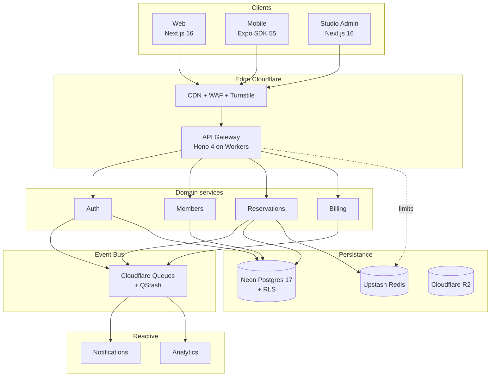

<div align="center">

# Athlya

**Plateforme fitness open-source, multi-tenant, RGPD-first**

Alternative auto-hébergeable à bsport, Mywellness et Mindbody pour les studios boutique, chaînes mid-size, coachs indépendants et communautés sportives.

[](.github/workflows/ci.yml)
[](.github/workflows/pgtap.yml)
[](.github/workflows/zap-baseline.yml)
[](.github/workflows/deps-audit.yml)
[](#licence)

[](https://www.typescriptlang.org/)
[](https://nodejs.org/)
[](https://pnpm.io/)
[](https://turbo.build/)
[](https://hono.dev/)
[](https://workers.cloudflare.com/)
[](https://www.postgresql.org/)
[](https://orm.drizzle.team/)
[](https://zod.dev/)
[](https://vitest.dev/)
[](https://fast-check.dev/)

[](#état-des-tests)
[-0ea5e9?style=flat-square>)](.kiro/specs/athlya-platform/tasks.md)
[](.kiro/specs/athlya-platform/PROGRESS.md)
[](#vie-privée--rgpd)
[](CHANGELOG.md)

</div>

---

## Table des matières

- [Aperçu](#aperçu)
- [Architecture](#architecture)
- [Stack technique](#stack-technique)
- [Démarrage](#démarrage)
- [État du projet](#état-du-projet)
- [État des tests](#état-des-tests)
- [Coûts opérationnels](#coûts-opérationnels)
- [Limites assumées (v0.1)](#limites-assumées-v01)
- [Vie privée — RGPD](#vie-privée--rgpd)
- [Procédure incident](#procédure-incident)
- [Matrice fournisseurs](#matrice-fournisseurs)
- [Conventions du monorepo](#conventions-du-monorepo)
- [Contribution](#contribution)
- [Licence](#licence)

---

## Aperçu

Athlya est un monorepo Turborepo qui regroupe trois applications clientes (web Next.js 16, mobile Expo SDK 55, studio admin Next.js 16) et une API edge Hono déployée sur Cloudflare Workers. La persistance repose sur Neon PostgreSQL 17 avec Row-Level Security, Upstash Redis pour les compteurs et limites, et un bus d'événements combinant Cloudflare Queues et Upstash QStash.

Quatre axiomes structurent l'architecture :

1. **Edge-first** — terminaison des requêtes au PoP Cloudflare le plus proche.
2. **Event-driven** — les effets de bord (emails, push, analytics) passent par un bus asynchrone, jamais en RPC dans la requête utilisateur.
3. **Local-first** — le mobile tient 72 h en lecture hors-ligne et bufferise les écritures dans une queue persistée (MMKV).
4. **Zero-trust / defense-in-depth** — JWT vérifié à l'edge, RLS PostgreSQL comme dernier rempart, validation Zod à chaque frontière.

Cibles SLO : p99 < 500 ms, disponibilité 99,9 %, zéro double-booking sous contention.

Les documents de spécification et de décision vivent dans [`.kiro/specs/athlya-platform/`](.kiro/specs/athlya-platform/) (`requirements.md`, `design.md`, `tasks.md`, `PROGRESS.md`, `hardening-plan.md`).

---

## Architecture



---

## Stack technique

### Runtime

| Couche                         | Technologie                        | Version |
| ------------------------------ | ---------------------------------- | ------- |
| Langage                        | TypeScript                         | 5.9     |
| Runtime serveur                | Node 20 LTS / Cloudflare Workers   | —       |
| Gestionnaire                   | pnpm workspaces                    | 9.15    |
| Build                          | Turborepo                          | 2.x     |
| Framework API                  | Hono                               | 4.x     |
| ORM                            | Drizzle                            | dernier |
| Base de données                | PostgreSQL + RLS                   | 17      |
| Cache / compteurs / rate limit | Upstash Redis                      | —       |
| Storage binaire                | Cloudflare R2                      | —       |
| Bus d'événements               | Cloudflare Queues + Upstash QStash | —       |
| Validation                     | Zod `.strict()`                    | 4.x     |

### Observabilité

| Signal      | Outil                        | Configuration                                           |
| ----------- | ---------------------------- | ------------------------------------------------------- |
| Traces OTel | **Axiom** (OTLP/HTTP JSON)   | endpoint configurable via `OTEL_EXPORTER_OTLP_ENDPOINT` |
| Logs        | JSON structuré, Axiom        | `traceId`, `method`, `path`, `status`, `durationMs`     |
| Métriques   | Cloudflare Analytics         | natif                                                   |
| Erreurs     | Sentry (envelope v7 minimal) | —                                                       |
| Uptime      | BetterStack                  | à configurer                                            |

### Sécurité

| Aspect           | Approche                                                      |
| ---------------- | ------------------------------------------------------------- |
| TLS              | 1.3 Cloudflare                                                |
| Auth             | JWT RS256 (access 15 min, refresh rotatif 30 j)               |
| Password         | bcrypt cost 12 + contrôle HIBP                                |
| Isolation tenant | RLS PostgreSQL `FORCE ROW LEVEL SECURITY`                     |
| Bot protection   | Cloudflare Turnstile sur register/login                       |
| Headers          | HSTS, X-Frame-Options, Referrer-Policy, CSP                   |
| Audit log        | Append-only (trigger + RLS `USING(false)` + SECURITY DEFINER) |

### Tests

| Niveau             | Outil                         | Nombre               |
| ------------------ | ----------------------------- | -------------------- |
| Unit + intégration | Vitest 3                      | ~790                 |
| Property-based     | fast-check 3.23               | 9 invariants formels |
| RLS PostgreSQL     | pgTAP en CI                   | ~60 assertions       |
| E2E (prévu)        | Playwright                    | —                    |
| Mobile (prévu)     | Maestro ou EAS Device Testing | —                    |

---

## Démarrage

### Prérequis

- **Node 20 LTS** (voir `.nvmrc`)
- **pnpm ≥ 9** (`corepack enable` suffit)
- **Docker** optionnel — requis uniquement pour les suites Testcontainers (RLS, cascade, booking property). Sans Docker, ces suites se skippent proprement via `describe.skipIf(!dockerReady)`.

### Installation

```bash
git clone https://github.com/GlamgarOnDiscord/athlya.git athlya
cd athlya
pnpm install
```

### Commandes racine

```bash
pnpm -r build             # build de tous les packages
pnpm -r test              # suite complète (suites Docker-gated s'auto-skippent)
pnpm -r typecheck         # typecheck global
pnpm -r lint              # ESLint 9 flat config
pnpm format               # Prettier write
pnpm format:check         # Prettier check
```

### Commandes par package

```bash
pnpm --filter @athlya/api dev              # wrangler dev local
pnpm --filter @athlya/api test             # ~315 tests
pnpm --filter @athlya/api typecheck
pnpm --filter @athlya/api deploy:staging
pnpm --filter @athlya/api deploy:production

pnpm --filter @athlya/db test              # vitest + pgTAP si Docker
pnpm --filter @athlya/ratelimit test       # 7 tests
pnpm --filter @athlya/auth test            # 85 tests
```

### Secrets

Les secrets ne vivent **jamais** dans `wrangler.toml`. Ils sont injectés par environnement via `wrangler secret put` :

```bash
wrangler secret put DB_URL                    --env staging
wrangler secret put REDIS_TOKEN               --env staging
wrangler secret put JWT_JWKS_URL              --env staging
wrangler secret put SENTRY_DSN                --env staging
wrangler secret put OTEL_EXPORTER_OTLP_ENDPOINT  --env staging
wrangler secret put OTEL_EXPORTER_OTLP_HEADERS   --env staging
# Exemple de valeur pour Axiom :
# https://api.axiom.co/v1/traces
# Authorization=Bearer <token>,X-Axiom-Dataset=athlya-staging
```

---

## État du projet

**~252 / 294 tâches livrées (~86 %)** — v1.1.0 : studio admin complet (CRUD classes, membres, identité visuelle, facturation) + correctifs UX web B1-B7. Mobile (Expo), AI coach et Stripe-mature en roadmap post-1.0.

Voir [`PROGRESS.md`](.kiro/specs/athlya-platform/PROGRESS.md) et [CHANGELOG.md](CHANGELOG.md) pour le détail.

| Épic                                 | État     |
| ------------------------------------ | -------- |
| 1 — Bootstrap monorepo               | ✅ 6/6   |
| 2 — Base de données, migrations, RLS | ✅ 7/7   |
| 3 — Authentification                 | ✅ 7/7   |
| 4 — Rate limiter & idempotency       | ✅ 3/3   |
| 5 — Members & RGPD                   | ✅ 7/7   |
| 6 — Reservations domain              | ✅ 11/11 |
| 7 — Checkpoint domaine               | ⏳ 0/1   |
| 8 — API Gateway Hono                 | 🟡 10/12 |
| 9 — Event bus, outbox, notifications | ✅ 7/7   |
| 10 — Web member app                  | ✅ 8/8   |
| 11 — Mobile Expo                     | ⏳ 0/13  |
| 12 — Admin studio app                | ✅ 6/6   |
| 13 — CI/CD & observability           | ✅ 5/5   |
| 14 — Checkpoint v0.1 MVP             | ⏳ 0/1   |
| 15 — Multi-tenant rollout            | 🟡 1/3   |
| 16 — Billing Stripe                  | 🟡 1/3   |
| 17 — Notifications extension         | 🟡 1/2   |
| 19 — i18n Accept-Language            | ✅ 2/2   |

**Hardening phase livrée** (insérée entre Epic 8 et Epic 10, voir [`hardening-plan.md`](.kiro/specs/athlya-platform/hardening-plan.md)) : H1 audit log SECURITY DEFINER, H2 DLQ drain, H3 circuit breaker per-isolate, H4 middleware chain tests, H5 `@athlya/ratelimit` extraction, H6 Axiom, H7 `.down.sql`, H8 README. Détail dans [CHANGELOG.md](CHANGELOG.md#1.0.0).

---

## État des tests

**~1 260 tests verts** répartis sur 10 packages.

| Package                 | Tests                      | Notes                                                   |
| ----------------------- | -------------------------- | ------------------------------------------------------- |
| `@athlya/shared`        | 146/146                    | dont 7 PBT round-trip (Req 21.3)                        |
| `@athlya/db`            | 57/57 (+ 4 Docker-gated)   | pgTAP RLS + audit anonymisation                         |
| `@athlya/auth`          | 123/123                    | —                                                       |
| `@athlya/ratelimit`     | 7/7                        | nouveau package (H5)                                    |
| `@athlya/api`           | **567/567**                | dont 16 chain tests + 23 DLQ + 15 circuit breaker + PBT |
| `@athlya/members`       | 72/72 (+ 2 Docker-gated)   | —                                                       |
| `@athlya/reservations`  | 111/111 (+ 2 Docker-gated) | dont PBT P1, P2, P3                                     |
| `@athlya/notifications` | 58/58                      | —                                                       |
| `@athlya/billing`       | 30/30                      | —                                                       |
| `@athlya/web`           | 89/89                      | —                                                       |

### Property-based tests (PBT, fast-check)

8 des 9 invariants formels sont validés. Un seul reste bloqué par le scaffolding mobile.

| Invariant | Description                                   | Statut            |
| --------- | --------------------------------------------- | ----------------- |
| P1        | Capacité (pas de surbooking sous concurrence) | ✅                |
| P2        | Idempotence de `bookClass`                    | ✅                |
| P3        | Monotonie de la state-machine réservation     | ✅                |
| P4        | Cascade RGPD complète                         | ✅                |
| P5        | Drain offline FIFO + idempotent               | ⏳ bloqué Epic 11 |
| P6        | JWT non-falsifiable et non-rejouable          | ✅                |
| P7        | Isolation tenant (cross-tenant = 0 row)       | ✅                |
| P8        | Exactitude sliding-window rate limit          | ✅                |
| —         | Round-trip de sérialisation des domaines      | ✅                |

Plus : property test circuit breaker "open state short-circuits fn" (H3) et "isolate independence".

---

## Coûts opérationnels

La promesse "free tier solo" de l'analyse concurrentielle initiale n'est pas atteignable sur un déploiement prod + staging réel. Voici un TCO honnête pour un studio pilote.

| Poste                    | Free tier          | Coût au 1er user payant                           |
| ------------------------ | ------------------ | ------------------------------------------------- |
| Neon Postgres            | 500 MB, 1 projet   | **~19 €/mois** (Launch plan pour staging + prod)  |
| Upstash Redis            | 10 000 req/jour    | **~10 €/mois** dès le 1er studio actif            |
| Cloudflare Workers       | 100 000 req/jour   | **~5 €/mois** (Paid plan pour CPU time + Queues)  |
| Resend                   | 100 mails/jour     | **~20 €/mois** (Pro à partir de 3 000 mails/mois) |
| Sentry                   | 5 000 events/mois  | **~26 €/mois** (Team)                             |
| Axiom                    | 500 GB ingest/mois | **0 €** si volume modeste                         |
| Stripe                   | % des ventes       | variable                                          |
| Domaine + DNS            | —                  | **~15 €/an**                                      |
| **Total staging + prod** |                    | **~80-100 €/mois** au démarrage                   |

> Au-delà de ~5 studios actifs ou ~500 membres : prévoir **150-250 €/mois**.

Si la contrainte budgétaire est forte, plusieurs composants ont des chemins d'éjection vers du self-hosted sans coût récurrent — voir [Matrice fournisseurs](#matrice-fournisseurs).

---

## Limites assumées (v0.1)

Décisions arrêtées lors de la hardening phase, documentées dans [`hardening-plan.md`](.kiro/specs/athlya-platform/hardening-plan.md).

### Circuit breaker — state per-isolate (H3)

L'état du circuit breaker (`packages/api/src/circuit-breaker.ts`) vit **en mémoire par isolate Cloudflare Workers**. Sous charge, un service downstream mort peut être touché par N requêtes (une par isolate vivant) à chaque cycle half-open, pas une seule globalement.

Accepté parce que :

- les isolates sont reapés après ~15 s d'inactivité, la dérive per-isolate se corrige d'elle-même
- la plateforme (Cloudflare retries, Hyperdrive fast-fail, Upstash SLA) absorbe déjà 90 % de la pression
- une version Redis coûterait +5-10 ms par appel downstream — contradiction directe avec le SLO p99 < 500 ms (Req 23.2)

### DLQ Cloudflare Queues — drain manuel (H2)

La DLQ `athlya-events-dlq` est drainée automatiquement par un worker consumer qui upsert chaque message dans un tracker Redis (`dlq:entry:<id>` + sorted set `dlq:pending`). La visibilité passe par des endpoints admin :

- `GET /admin/dlq/stats` — snapshot de la DLQ (admin-only, 403 Problem Details sinon)
- `POST /admin/dlq/replay/:id` — re-publication manuelle sur le bus (404 si inconnu)
- `POST /admin/dlq/discard/:id` — abandon de l'entrée (idempotent)

**Pas d'alerte automatique** sur DLQ non vide — à configurer côté Axiom avec une query sur le log structuré `"[dlq] drain cycle complete" AND totalPending > 0`.

### Testcontainers — skip-on-Docker

Les suites PBT qui valident P1 capacity, P4 RGPD cascade, P7 tenant isolation utilisent Testcontainers Postgres + Redis. Elles se skippent proprement sur les postes sans Docker (incluant Windows local) via `describe.skipIf(!dockerReady)`. Seul le workflow CI `.github/workflows/pgtap.yml` les exécute réellement — chaque PR qui touche une migration SQL les déclenche.

### Exporter OTel — hand-rolled (task 8.6)

`packages/api/src/middleware/otel.ts` roule son propre exporter OTLP/HTTP JSON au lieu d'utiliser `@opentelemetry/sdk-trace-*`. Raison : bundle Worker ~200 KB évité. Compatible avec Axiom, Grafana Cloud, Honeycomb et tout backend OTLP standard. Conséquence : pas de debug via `otel-collector` CLI, envelope à maintenir nous-mêmes.

### Sentry — envelope minimal (task 8.7)

`packages/api/src/sentry.ts` envoie un envelope v7 POST direct au DSN ingest URL, sans `@sentry/cloudflare`. Fournit `captureException(err, { traceId, tags, extra })`. **Ne fournit pas** breadcrumbs, session tracking, release health, source maps upload. Pour passer à la vraie lib, remplacer le fichier le jour où le plan Sentry Team devient justifié.

---

## Vie privée — RGPD

Athlya est RGPD-first : le consentement granulaire, la portabilité et le droit à l'oubli sont des features de premier rang, pas une couche ajoutée.

### Consentement versionné

Chaque utilisateur a un champ `consents` JSON :

```json
{
  "marketing": false,
  "analytics": true,
  "thirdParty": false,
  "version": "2026-01",
  "updatedAt": "2026-05-10T10:23:00Z"
}
```

Chaque changement est horodaté avec la version des CGU en vigueur.

### Export self-service (Req 4)

`POST /v1/members/me/export` enfile un job asynchrone. Sous 48 h, un email avec un lien signé 72 h permet de télécharger un ZIP (JSON + CSV) contenant profil, consentements, réservations, séances, check-ins et factures.

### Droit à l'oubli (Req 5)

`DELETE /v1/auth/me` marque soft-delete puis un consumer Cloudflare Queues cascade les suppressions (réservations, sessions, push tokens, avatar R2). À J+30, un job cron anonymise les entrées `audit_log` référençant l'utilisateur via la fonction PostgreSQL **`SECURITY DEFINER`** `anonymize_user_audit(uuid)` — unique chemin de mutation autorisé sur la table append-only.

### Append-only audit log

L'intégrité de l'`audit_log` est garantie par **quatre lignes de défense** superposées :

1. **Privilèges SQL** — `REVOKE UPDATE, DELETE FROM PUBLIC, athlya_app, athlya_cron`
2. **Policies RLS** — `CREATE POLICY audit_no_update ... USING (false)`, idem pour DELETE
3. **Trigger** — `audit_log_immutable()` raise `audit_log is append-only` pour tout `current_user` différent de `athlya_owner`
4. **Ownership + BYPASSRLS** — table `audit_log` ownée par `athlya_owner`, seul rôle capable d'exécuter la fonction SECURITY DEFINER

### Résidence EU

Données hébergées exclusivement en UE : Neon Frankfurt, Cloudflare EU PoPs, Upstash EU, Resend EU (Req 5.5).

---

## Procédure incident

1. Récupérer le **`x-trace-id`** depuis le header de réponse ou le front
2. **Axiom** — query `tags.trace_id = "<id>"` sur le dataset `athlya-api` (spans OTel avec `http.method`, `http.route`, `http.status_code`, `studio.id`, `user.id`)
3. **Sentry** — event avec tag `trace_id` pour la stack backend
4. **Wrangler Tail** — `wrangler tail --env production` pour les logs JSON en direct
5. **DLQ** — `GET /admin/dlq/stats` pour les messages non consommés sur le bus

### Rollback d'une migration

Chaque migration a un `.down.sql` FK-safe. Rollback en incident, ordre inverse :

```bash
psql $DB_URL -f packages/db/migrations/0003_audit_anonymization.down.sql
psql $DB_URL -f packages/db/migrations/0002_export_jobs.down.sql
psql $DB_URL -f packages/db/migrations/0001_rls.down.sql
psql $DB_URL -f packages/db/migrations/0000_init.down.sql
```

Tous les rollbacks sont idempotents (`DROP ... IF EXISTS`). Les extensions PostgreSQL (`pgcrypto`, `citext`) ne sont **jamais** droppées (cluster-shared). Voir [`packages/db/migrations/README.md`](packages/db/migrations/README.md).

---

## Matrice fournisseurs

Le vendor lock-in est un des griefs principaux adressés aux SaaS concurrents. Chaque fournisseur utilisé par Athlya a un chemin d'éjection documenté.

| Service            | Alternative                                       | Effort de migration                                   |
| ------------------ | ------------------------------------------------- | ----------------------------------------------------- |
| Neon Postgres      | Postgres 17 standard (Supabase, RDS, self-hosted) | 🟢 Faible — Drizzle portable, migrations SQL pures    |
| Upstash Redis      | Redis self-hosted, KeyDB, Dragonfly               | 🟢 Faible — API REST standard                         |
| Cloudflare Queues  | RabbitMQ, AWS SQS, QStash seul                    | 🟡 Moyen — outbox pattern préserve l'invariant        |
| Resend             | SMTP + nodemailer, Mailgun, Postmark              | 🟢 Faible — DI port dans `@athlya/notifications`      |
| Cloudflare Workers | Node.js standalone (Hono), Bun, Deno              | 🟡 Moyen — code framework-free, bindings à rebrancher |
| Stripe             | Adyen, Mollie, Lemon Squeezy                      | 🔴 Élevé — adapter Billing dédié                      |
| Axiom              | Grafana Cloud, Honeycomb, tout backend OTLP       | 🟢 Nul — endpoint configurable                        |
| Sentry             | Glitchtip (open-source), Highlight                | 🟡 Moyen — envelope v7 est un protocole stable        |

---

## Conventions du monorepo

- **pnpm workspaces** + **Turborepo 2.x**
- **Node 20 LTS** pinné via `.nvmrc` + `engines`
- **TypeScript 5.9** strict, **ESLint 9** flat config, **Prettier 3**
- Packages domaine **framework-free** avec DI ports (Repo, Counter, Publisher, Store)
- **Hono** est peerDependency optionnelle de `@athlya/api` ; les middlewares sont duck-typés sur un contexte minimal `{ header(k,v); set; get; req; env }`
- **Zod `.strict()`** sur tous les bodies de requête sauf `AuditLog.metadata`
- **Branded IDs** via `.transform()` (pas `Zod.brand()`)
- **fast-check ^3.23.2** + `@fast-check/vitest` pour les PBT, `numRuns` 20-200, seeds hex fixes
- Testcontainers : sonde synchrone `docker info` au module load + `describe.skipIf(!dockerReady)` ; un test "infra probe" toujours enregistré
- Worker bundle : aucun import Node-only, `crypto.getRandomValues` / `crypto.randomUUID` globaux Web

### Structure des packages

```
packages/
├── api/            # Gateway Hono + middlewares (auth, tenant, otel, ratelimit, validator, problem-details)
├── auth/           # Service d'authentification, JWT, QR check-in
├── billing/        # Stripe Connect (DI port)
├── db/             # Schémas Drizzle, RLS policies, migrations + down.sql
├── members/        # Profils, consents, export/cascade RGPD
├── notifications/  # Consumer du bus → Resend + Expo Push
├── ratelimit/      # Sliding window Upstash (extrait de api en H5)
├── reservations/   # Domaine critique (bookClass, cancel, waitlist, checkin)
├── shared/         # Tokens design, i18n, schémas Zod, codecs, événements
├── eslint-config/  # Flat config partagée
├── prettier-config/
└── tsconfig/       # Presets base, node, react, next
```

---

## Contribution

1. Lire [`project.md`](project.md) pour le pitch et la rationale de stack
2. Lire [`.kiro/specs/athlya-platform/requirements.md`](.kiro/specs/athlya-platform/requirements.md) et [`design.md`](.kiro/specs/athlya-platform/design.md) avant tout PR qui touche un invariant formel
3. `pnpm -r typecheck && pnpm -r test` doivent passer vert
4. Suivre les conventions ESLint + Prettier (`pnpm format` avant push)
5. Toute migration SQL doit avoir son `.down.sql`
6. Tout nouveau middleware doit avoir ses unit tests **et** un cas dans `middleware-chain.test.ts`

---

## Licence

[AGPL-3.0-only](LICENSE)

Copyleft fort par choix : la valeur d'Athlya repose sur la propriété des données pour l'opérateur — une licence permissive autoriserait un fork propriétaire qui reproduirait le vendor lock-in que le projet vise à combattre.

---

<div align="center">

**[Documentation](.kiro/specs/athlya-platform/) · [Progress](.kiro/specs/athlya-platform/PROGRESS.md) · [Hardening](.kiro/specs/athlya-platform/hardening-plan.md) · [Critique](critique.md)**

Construit pour les studios qui veulent leurs données.

</div>
