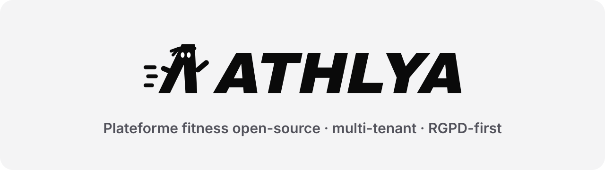
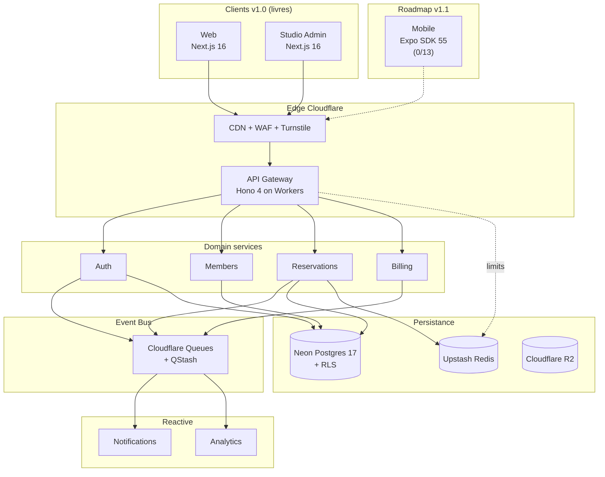

<div align="center">

<picture>
  <source media="(prefers-color-scheme: dark)" srcset="assets/brand/readme/banner-dark.svg">
  
</picture>

<br/>

**La plateforme fitness open-source qui laisse les studios propriétaires de leurs données.**<br/>
Réservations, membres, paiements et suivi d'entraînement. Multi-tenant, RGPD-first, servie à l'edge.

<br/>

[](https://github.com/GlamgarOnDiscord/athlya/actions/workflows/ci.yml)
[](https://github.com/GlamgarOnDiscord/athlya/actions/workflows/pgtap.yml)
[](https://github.com/GlamgarOnDiscord/athlya/actions/workflows/codeql.yml)
[](#licence)

[Démarrer](#-démarrer) · [Architecture](#-architecture) · [Stack](#-stack) · [Documentation](#-documentation) · [Contribuer](#-contribuer)

</div>

---

## ⚡ En bref

<table>
<tr>
<td width="33%" valign="top">

### 🏋️ Pour les studios

Planning, réservations sans double-booking, liste d'attente automatique, abonnements Stripe, programmes d'entraînement et back-office dédié.

</td>
<td width="33%" valign="top">

### 📱 Pour les membres

Réserver en deux taps, check-in QR, suivi des séances et de la progression, export et suppression de ses données en self-service.

</td>
<td width="33%" valign="top">

### 🔐 Pour les opérateurs

Auto-hébergeable, licence AGPL, données en UE, isolation par Row-Level Security et audit log append-only.

</td>
</tr>
</table>

|                     |                                                                                                         |
| ------------------- | ------------------------------------------------------------------------------------------------------- |
| 🌍 **Edge-first**   | Requêtes terminées au PoP Cloudflare le plus proche (Hono sur Workers)                                  |
| 📨 **Event-driven** | Emails, push et analytics passent par une outbox transactionnelle et des queues, jamais dans la requête |
| 🛡️ **Zero-trust**   | JWT vérifié à l'edge, validation Zod à chaque frontière, RLS PostgreSQL en dernier rempart              |
| 🎯 **SLO**          | p99 &lt; 500 ms · 99,9 % de disponibilité · zéro double-booking sous contention                         |

---

## 🧭 Architecture



---

## 🧰 Stack

<p>


</p>

| Couche            | Choix                                                                                     |
| ----------------- | ----------------------------------------------------------------------------------------- |
| **Apps**          | Web membre et studio admin en Next.js 16 · mobile Expo en cours                           |
| **API**           | Hono 4 sur Cloudflare Workers, découpée en workers bulkhead (auth, réservations, billing) |
| **Données**       | Neon PostgreSQL 17 + RLS forcée · Drizzle · Upstash Redis · Cloudflare R2                 |
| **Événements**    | Outbox transactionnelle + Cloudflare Queues, drain déclenché à chaque écriture            |
| **Paiements**     | Stripe (abonnements, webhooks idempotents)                                                |
| **Observabilité** | OpenTelemetry → Axiom, Sentry, monitors SLO en Terraform                                  |
| **Qualité**       | Vitest, fast-check (property-based), pgTAP, Playwright + axe, CodeQL, gitleaks            |

Le détail (observabilité, sécurité, tests) est dans le [manuel du projet](docs/project-handbook.md#stack-détaillée).

---

## 🚀 Démarrer

**Prérequis** : Node 24 LTS (`.nvmrc`), pnpm 11 (`corepack enable`). Docker est optionnel : sans lui, les suites Testcontainers se désactivent proprement.

```bash
git clone https://github.com/GlamgarOnDiscord/athlya.git
cd athlya
pnpm install
pnpm preflight   # install figé · format · lint · typecheck · tests · build
```

<details>
<summary><b>Commandes utiles</b></summary>

```bash
pnpm -r test                                # toute la suite
pnpm -r typecheck                           # typecheck global
pnpm format                                 # Prettier
pnpm --filter @athlya/api dev               # API locale (wrangler dev)
pnpm --filter @athlya/web dev               # web membre
pnpm --filter @athlya/studio dev            # studio admin
pnpm --filter @athlya/api deploy:staging    # déploiement staging
```

</details>

<details>
<summary><b>Secrets</b></summary>

Aucun secret dans `wrangler.toml` ni dans le repo (public, gitleaks en CI). Ils sont injectés par environnement :

```bash
wrangler secret put DB_URL --env staging
wrangler secret put REDIS_TOKEN --env staging
wrangler secret put JWT_JWKS_URL --env staging
```

La liste complète par Worker est vérifiée par `scripts/verify-secrets.mjs` avant chaque déploiement.

</details>

---

## 📚 Documentation

|                         |                                                                                                                                                                                                                                        |
| ----------------------- | -------------------------------------------------------------------------------------------------------------------------------------------------------------------------------------------------------------------------------------- |
| 📐 **Spécifications**   | [Exigences](.kiro/specs/athlya-platform/requirements.md) · [Design](.kiro/specs/athlya-platform/design.md) · [Tâches](.kiro/specs/athlya-platform/tasks.md) · [Avancement](.kiro/specs/athlya-platform/PROGRESS.md)                    |
| 📖 **Manuel du projet** | [État, tests, coûts, limites, RGPD, incidents, fournisseurs](docs/project-handbook.md)                                                                                                                                                 |
| 🛠️ **Runbooks**         | [Déploiement](docs/runbooks/deploy-production.md) · [Rollback](docs/runbooks/automatic-rollback.md) · [Migrations](docs/runbooks/expand-contract-migrations.md) · [Rôles DB](docs/runbooks/db-role-switch.md) · [tous](docs/runbooks/) |
| 🔒 **Sécurité**         | [Dossier sécurité](docs/security/) · [Politique](SECURITY.md)                                                                                                                                                                          |
| 🎨 **Marque**           | [Logo, mascotte, couleurs](docs/brand/README.md)                                                                                                                                                                                       |
| 📝 **Historique**       | [CHANGELOG](CHANGELOG.md)                                                                                                                                                                                                              |

---

## 🇪🇺 Vie privée

Consentements versionnés, export de ses données en self-service, droit à l'oubli avec cascade et purge planifiée, audit log append-only, hébergement des données en UE. Détails dans le [manuel du projet](docs/project-handbook.md#vie-privée--rgpd).

---

## 🤝 Contribuer

1. Lire [`project.md`](project.md), puis les [exigences](.kiro/specs/athlya-platform/requirements.md) et le [design](.kiro/specs/athlya-platform/design.md) avant de toucher un invariant.
2. Suivre le workflow décrit dans [`CONTRIBUTING.md`](CONTRIBUTING.md) : issue → branche → PR, revues IA obligatoires.
3. `pnpm preflight` doit être vert avant chaque push.
4. Migrations SQL en expand/contract, toujours avec leur `.down.sql`.

---

## Licence

[AGPL-3.0-only](LICENSE). Un copyleft fort, par choix : la valeur d'Athlya, c'est que l'opérateur reste propriétaire de ses données. Une licence permissive autoriserait un fork propriétaire qui recréerait le vendor lock-in que le projet combat.

<br/>

<div align="center">

<br/>
<sub>Construit pour les studios qui veulent garder leurs données.</sub>
</div>
