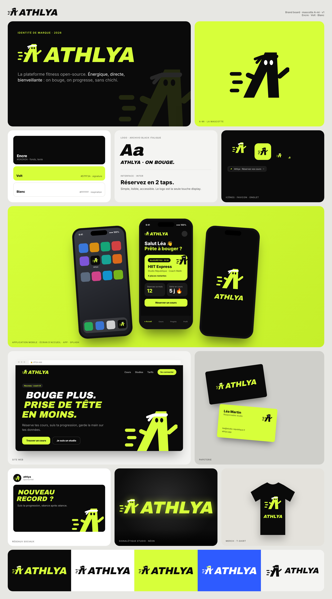
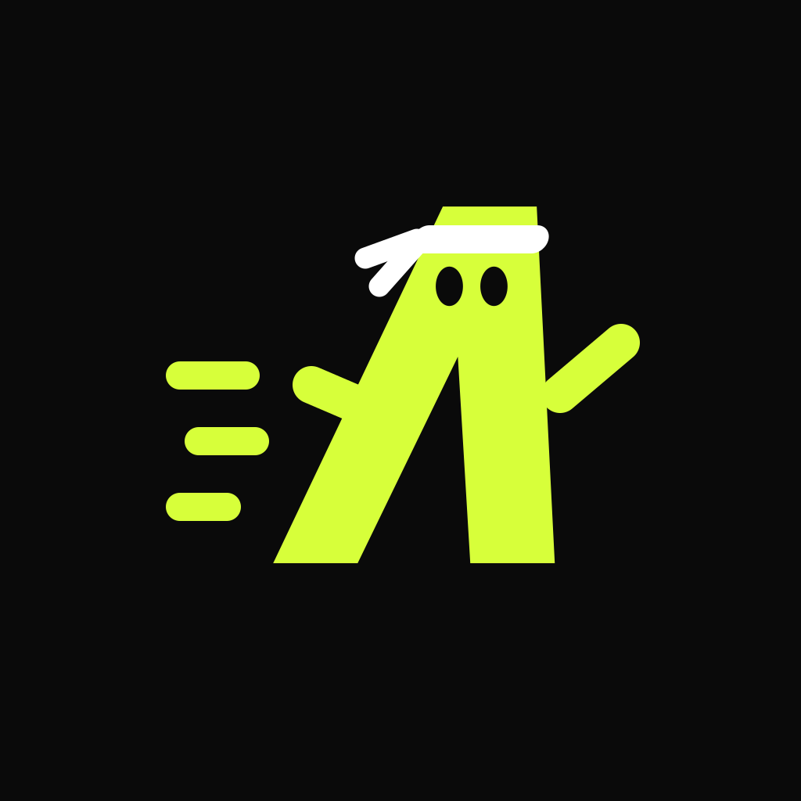
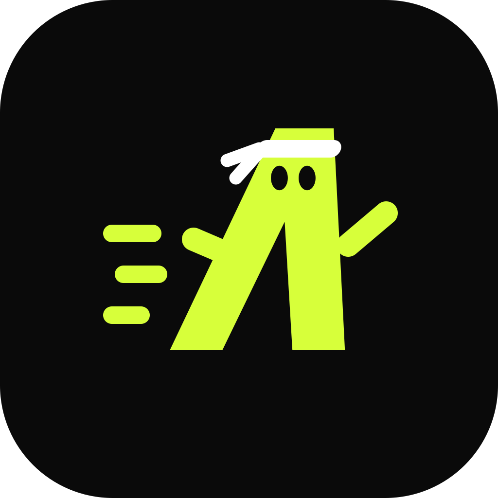
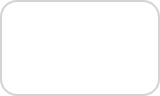

<div align="center">

<picture>
  <source media="(prefers-color-scheme: dark)" srcset="../../assets/brand/readme/banner-dark.svg">
  
</picture>

# Identité de marque

**A-mi**, la mascotte d'Athlya : un « A » italique qui court, bandeau au front.

</div>

---



---

## L'essentiel

| Principe     | Règle                                                                      |
| ------------ | -------------------------------------------------------------------------- |
| Personnalité | Énergique, directe, bienveillante : on bouge, on progresse, sans chichi    |
| Forme        | Un seul aplat, angles francs, inclinaison de 12° partout                   |
| Couleurs     | Trois et pas plus : encre, volt, blanc                                     |
| Typo du logo | Archivo Black, italique 12°, convertie en tracés (aucune police à charger) |

---

## Déclinaisons

| Variante                               | Aperçu                                                                                        | Fichier                                                                      | Usage                                 |
| -------------------------------------- | --------------------------------------------------------------------------------------------- | ---------------------------------------------------------------------------- | ------------------------------------- |
| **Logo complet** (mascotte + wordmark) |  | `athlya-lockup-{volt,ink,white}.svg`                                         | Header, site, documents, OG           |
| **Mascotte seule**                     |       | `athlya-mascot-{volt,ink,white,mono}.svg`                                    | Avatar, petits formats, illustrations |
| **Wordmark seul**                      |   | `athlya-wordmark-{volt,ink,white}.svg`                                       | Quand la mascotte est déjà présente   |
| **Icône d'app**                        |            | `athlya-appicon.svg`, `athlya-appicon-light.svg`, `png/athlya-appicon-*.png` | Stores, PWA, écran d'accueil          |
| **Favicon**                            |                | `athlya-favicon.svg`, `png/favicon.ico`                                      | Onglets navigateur                    |

Tous les sources vivent dans [`assets/brand/svg/`](../../assets/brand/svg/) ; les exports raster dans [`assets/brand/png/`](../../assets/brand/png/).

### Choisir la bonne version

| Fond                    | Version                                                                                                |
| ----------------------- | ------------------------------------------------------------------------------------------------------ |
| Noir / sombre           | `volt` (signature) ou `white`                                                                          |
| Blanc / clair           | `ink`                                                                                                  |
| Volt                    | `ink`                                                                                                  |
| Photo ou couleur vive   | `white`, ou `ink` si le fond est clair                                                                 |
| Interface (web, studio) | composant `<AthlyaLogo />` : hérite de `currentColor`, les yeux sont découpés et laissent voir le fond |

---

## Couleurs

|                                                                               | Nom       | Hex       | Rôle                                                |
| ----------------------------------------------------------------------------- | --------- | --------- | --------------------------------------------------- |
|    | **Encre** | `#0A0A0A` | Fond signature, texte, logo sur clair               |
|    | **Volt**  | `#D7FF3A` | Couleur signature : logo sur sombre, accents, focus |
|  | **Blanc** | `#FFFFFF` | Fond clair, bandeau de la mascotte sur sombre       |

Le volt ne s'utilise **jamais** pour du texte sur fond blanc : le contraste est insuffisant (WCAG). Sur blanc, le logo est toujours en encre.

---

## Typographie

- **Logo** : Archivo Black, capitales, italique 12°, approche −1 %. Déjà vectorisé : ne jamais retaper « ATHLYA » dans une police.
- **Interface** : la police système de l'app reste inchangée. Le logo est la seule touche display.

---

## Espace et tailles

- **Zone de protection** : autour du logo, laisser au minimum la largeur d'un œil × 4 (≈ la hauteur du bandeau × 2). Pas de texte ni de bord dans cette zone.
- **Tailles minimales** : logo complet **≥ 96 px** de large (24 px de haut), mascotte seule **≥ 16 px**, favicon à partir de 16 px.

---

## À faire / à éviter

| ✅ À faire                                | ❌ À éviter                                |
| ----------------------------------------- | ------------------------------------------ |
| Utiliser les fichiers fournis tels quels  | Redessiner, déformer ou étirer             |
| Garder l'inclinaison et les proportions   | Redresser la mascotte ou changer l'angle   |
| Encre sur clair, volt ou blanc sur sombre | Dégradés, ombres, contours, effets 3D      |
| Laisser respirer (zone de protection)     | Volt sur fond blanc, couleurs hors palette |
| Mascotte seule en petit format            | Ajouter un slogan collé au logo            |

---

## Régénérer les fichiers

Les SVG sont produits par [`assets/brand/scripts/build-brand.mjs`](../../assets/brand/scripts/build-brand.mjs) : c'est la source de vérité, ne pas éditer les SVG à la main.

```bash
mkdir -p /tmp/athlya-brand && cd /tmp/athlya-brand
npm i opentype.js@1.3.4 @fontsource/archivo-black@5.1.0
node /chemin/vers/athlya/assets/brand/scripts/build-brand.mjs /chemin/vers/athlya/assets/brand/svg
```

Le composant `AthlyaLogo.tsx` (web et studio) reprend les mêmes tracés.

## Licence de la police

Archivo Black © The Archivo Project Authors, sous [SIL Open Font License 1.1](https://openfontlicense.org). Seuls les contours des glyphes sont embarqués dans les SVG ; aucun fichier de police n'est redistribué.
